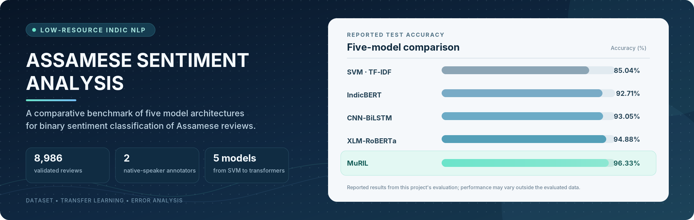
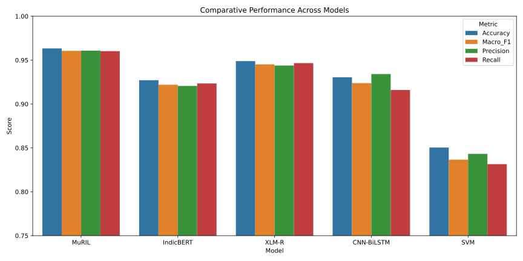
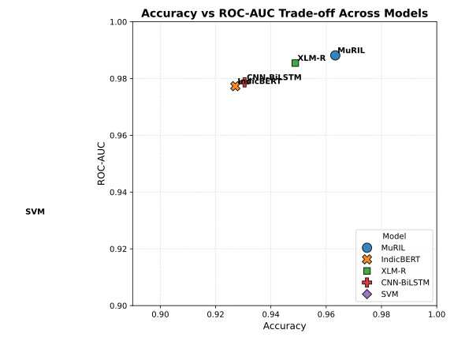

<p align="center">
  
</p>

# Assamese Sentiment Analysis — Transfer Learning Models 🇮🇳

<p align="center">
  <a href="https://github.com/AvinabhDutta-Dev/assamese-sentiment-analysis">
    
  </a>
  <a href="https://github.com/AvinabhDutta-Dev/assamese-sentiment-analysis/commits/main">
    
  </a>
  <a href="https://github.com/AvinabhDutta-Dev/assamese-sentiment-analysis">
    
  </a>
  <a href="https://github.com/AvinabhDutta-Dev/assamese-sentiment-analysis">
    
  </a>
</p>

<p align="center">
  <a href="https://huggingface.co/collections/AvinabhDutta-Dev/assamese-sentiment-analysis-models-and-dataset">
    
  </a>
  <a href="https://huggingface.co/datasets/AvinabhDutta-Dev/assamese-movie-reviews-sentiment">
    
  </a>
  <a href="https://doi.org/10.2139/ssrn.6357982">
    
  </a>
</p>

A comparative study benchmarking five machine learning and deep learning architectures for binary sentiment classification on Assamese-language movie reviews — built to address the near-total absence of sentiment analysis resources for Assamese, a low-resource Indic language.

📄 **Preprint:** [Sentiment Analysis of Assamese Reviews using Transfer Learning Models](https://www.researchgate.net/publication/401660577_Sentiment_Analysis_of_Assamese_Reviews_using_Transfer_Learning_Models) (DOI: [10.2139/ssrn.6357982](https://doi.org/10.2139/ssrn.6357982))

---

## 🛠️ Tech Stack

| Layer | Technology |
|---|---|
| Traditional ML |  Scikit-learn (SVM), TF-IDF |
| Deep Learning |  TensorFlow / Keras (CNN-BiLSTM) |
| Transformers |  Hugging Face `transformers` (MuRIL, IndicBERT, XLM-RoBERTa) |
| Data Processing |  Pandas,  NumPy |
| Evaluation & Visualization | Scikit-learn metrics, Matplotlib, Seaborn |
| Model Hosting |  Hugging Face Hub |

---

## 📊 Dataset

- **Dataset size:** 8,987 raw records, of which 8,986 are validated reviews after excluding one corrupted entry. The reviews were dual-annotated by two native-speaker annotators.
- **8,987 Assamese movie reviews**, dual-annotated by 2 native-speaker annotators.
- **Inter-annotator agreement:** 97.33% (Cohen's Kappa = 0.942).
- Labels: binary sentiment (**Positive** / **Negative**).

---

## 🤖 Models

All five trained models are hosted on Hugging Face Hub (weights excluded from this repo due to size):

| Model | Type | Accuracy | Hugging Face Link |
|---|---|---|---|
| SVM (TF-IDF + LinearSVC) | Traditional ML baseline | 85.04% | [assamese-sentiment-svm](https://huggingface.co/AvinabhDutta-Dev/assamese-sentiment-svm) |
| CNN-BiLSTM | Deep Learning (trained from scratch) | 93.05% | [assamese-sentiment-cnn-bilstm](https://huggingface.co/AvinabhDutta-Dev/assamese-sentiment-cnn-bilstm) |
| IndicBERT (ai4bharat/indic-bert) | Transformer | 92.71% | [assamese-sentiment-indicbert](https://huggingface.co/AvinabhDutta-Dev/assamese-sentiment-indicbert) |
| XLM-RoBERTa (base) | Transformer | 94.88% | [assamese-sentiment-xlmr](https://huggingface.co/AvinabhDutta-Dev/assamese-sentiment-xlmr) |
| **MuRIL** (fine-tuned) | Transformer | **96.33%** | [assamese-sentiment-muril](https://huggingface.co/AvinabhDutta-Dev/assamese-sentiment-muril) |

**Best performing model: MuRIL — 96.33% accuracy.**

---

## 📁 Project Structure

```
Assamese_Sentiment_Analysis/
├── Notebooks/
│   ├── 01_data_preprocessing.ipynb
│   ├── 02_transfer_muril.ipynb
│   ├── 03_transfer_indicbert.ipynb
│   ├── 04_transfer_xlm-r.ipynb
│   ├── 05_cnn_bilstm.ipynb
│   ├── 06_svm_baseline.ipynb
│   ├── 07_comparative_analysis.ipynb
│   ├── 08_Prediction_Demo.ipynb
│   ├── 09_muril_seed_stability.ipynb
│   └── EDA.ipynb
├── Data/
│   ├── Assamese_Movie_Review_8987_Labelled by 2 Annotators.csv
│   ├── Assamese_Movie_Review_Shuffled_8987.csv
│   ├── Assamese_Movie_Review_Cleaned_8987.csv
│   └── Assamese_Dataset_details.csv
├── Results/
│   ├── Comparisons/
│   ├── Confusion Matrix/
│   └── Dataset Visualizations/
├── Models/
│   ├── CNN_BiLSTM/
│   │   └── tokenizer.pkl
│   └── SVM/
│       ├── svm_model.joblib
│       └── tfidf_vectorizer.joblib
```

---

## 📈 Results

| Model | Accuracy | Macro F1 | Macro Precision | Macro Recall | ROC-AUC | Cohen's Kappa |
|---|---|---|---|---|---|---|
| SVM (baseline) | 85.04% | 0.8366 | 0.8432 | 0.8315 | 0.9314 | 0.6734 |
| IndicBERT | 92.71% | 0.9220 | 0.9206 | 0.9234 | 0.9773 | 0.8439 |
| CNN-BiLSTM | 93.05% | 0.9238 | 0.9341 | 0.9160 | 0.9787 | 0.8477 |
| XLM-RoBERTa | 94.88% | 0.9452 | 0.9438 | 0.9466 | 0.9855 | 0.8904 |
| **MuRIL** | **96.33%** | **0.9605** | **0.9608** | **0.9602** | **0.9882** | **0.9211** |

**MuRIL is the best-performing model**, followed by XLM-R, CNN-BiLSTM, IndicBERT, and SVM as the traditional ML baseline. Interestingly, the custom CNN-BiLSTM baseline slightly *outperforms* IndicBERT despite having no pretrained language representations — likely due to IndicBERT's smaller capacity and generalized multilingual representation diluting Assamese-specific nuance.

MuRIL's result was further validated for robustness across 5 random seeds (σ < 0.4%).

See `Results/Comparisons/` for full bar chart, radar chart, and per-model confusion matrices.

---

---

## Results Visualizations

<table>
  <tr>
    <td width="50%" valign="top">
      <strong>Model comparison</strong><br />
      
    </td>
    <td width="50%" valign="top">
      <strong>Accuracy vs. ROC-AUC</strong><br />
      
    </td>
  </tr>
  <tr>
    <td width="50%" valign="top">
      <strong>MuRIL confusion matrix</strong><br />
      
    </td>
    <td width="50%" valign="top">
      <strong>Dataset distribution</strong><br />
      
    </td>
  </tr>
</table>

For the complete set of comparison charts, confusion matrices, ROC curves, and training plots, see the `Results/` directory.

---

## 🔍 Key Findings

- **MuRIL's regional advantage:** MuRIL outperforms all other transformers, likely due to its pretraining being explicitly optimized for Indian languages and their morphological structures — unlike XLM-R and IndicBERT, which spread representational capacity across 100+ languages globally.
- **The "curse of multilinguality":** XLM-R, despite strong overall performance (94.88%), shows a diluted representation space for lower-resource scripts like Assamese due to its massive multilingual pretraining footprint.
- **CNN-BiLSTM vs. IndicBERT:** The custom-trained CNN-BiLSTM baseline (93.05%) slightly outperforms IndicBERT (92.71%) — suggesting IndicBERT's smaller architecture and generalized representations underperform relative to a task-specific model trained directly on domain data.
- **A shared weakness — negation and contrast:** All models, including MuRIL, struggle with **hard negation-contrast shifts** (e.g., sentences using Assamese contrast markers like *কিন্তু* or *কাৰণ* alongside positive words), often misclassifying them as false positives. This points to a broader limitation in current low-resource sentiment models: none genuinely model discourse-level context or implicit sentiment reversal.

---

## ⚙️ Setup

```bash
git clone https://github.com/AvinabhDutta-Dev/assamese-sentiment-analysis.git
cd assamese-sentiment-analysis
pip install -r requirements.txt
```

To use a trained model, download it directly from its Hugging Face repo (linked above) — e.g.:

```python
from transformers import AutoModelForSequenceClassification, AutoTokenizer

model = AutoModelForSequenceClassification.from_pretrained("AvinabhDutta-Dev/assamese-sentiment-muril")
tokenizer = AutoTokenizer.from_pretrained("AvinabhDutta-Dev/assamese-sentiment-muril")
```

---

## 📦 Requirements

`transformers`, `torch`, `tensorflow`, `scikit-learn`, `pandas`, `numpy`, `matplotlib`, `seaborn`, `joblib`

---

## 📝 Notes

- Trained model weights are hosted on Hugging Face Hub (not in this repo) due to file size — MuRIL, IndicBERT, and XLM-R exceed GitHub's 100MB per-file limit.
- Dataset is dual-annotated for quality assurance; raw, shuffled, and cleaned versions are all included for transparency.
- Full write-up and methodology are available in the linked preprint.

## Licensing & Citation

### Dataset License

The dataset is licensed under CC-BY-4.0.
See the [Hugging Face dataset card](https://huggingface.co/datasets/AvinabhDutta-Dev/assamese-movie-reviews-sentiment)
for its terms.

### Model Licenses

Refer to each model's Hugging Face card for its applicable license.

### Preprint

Please refer to the linked preprint's published terms for reuse and distribution. 

This means you are free to share and adapt the material for any purpose, even commercially, as long as you give appropriate credit by citing our preprint:

```bibtex
@article{dev2026assamese,
  title={Sentiment Analysis of Assamese Reviews using Transfer Learning Models},
  author={Dev, Chandana and Baishya, Bhumika and Dey, Nisha and Dutta, Avinabh and Dutta, Saurav},
  year={2026},
  doi={10.2139/ssrn.6357982}
}
```
